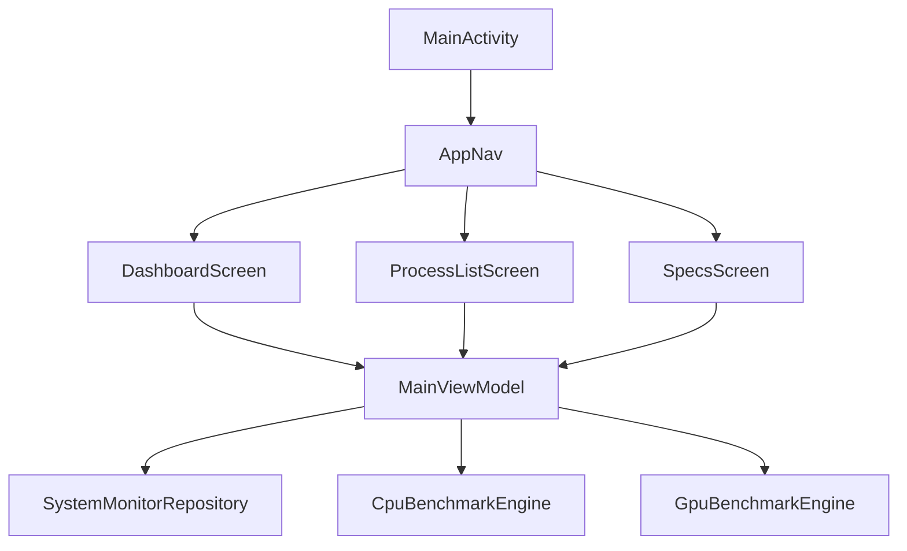

<div align="center">

# Pulse

### The heartbeat of your device.

Pulse is a modern, high-performance system monitor, hardware benchmarker, and advanced task manager built for Android.


</div>

---

## Why this exists

Modern mobile devices are powerhouse computers, yet understanding real-time system performance, CPU load, GPU utilization, memory pressure, and active background processes often requires cluttered, ad-heavy diagnostic tools.

Pulse turns device telemetry into a clean, responsive, and expressive dashboard. Created natively for Android using Jetpack Compose, Pulse provides instant visibility into hardware performance, real-time metrics, and process control without tracking endpoints, accounts, or intrusive advertisements.

The project is designed around a fast, transparent workflow:

```text
Open app -> View dashboard -> Inspect metrics & processes -> Run benchmarks -> Monitor in real time
```

There is no account system, sign-in flow, advertising SDK, telemetry collection, or external data logging.

## What it provides

| Capability | Description |
|------------|-------------|
| Real-time dashboard | Live visual monitoring of CPU, RAM, storage, and network statistics |
| Hardware benchmarking | Dedicated CPU and GPU benchmarking engines to test device performance |
| Process management | Inspect active app processes, threads, and handle counts |
| Device specifications | Detailed hardware breakdown of processor, chipset, and memory |
| Expressive UI cards | Material 3 cards with real-time graphs and smooth animations |
| Offline workflow | Complete monitoring and benchmarking without account or network access |

## Features

### Dashboard & Telemetry

- Real-time CPU usage and frequency monitoring
- RAM utilization breakdown (used, total, cached, compressed)
- Storage throughput (read/write speeds) and capacity monitoring
- Network speeds (upload/download) and Wi-Fi signal details
- Smooth real-time interactive graphs for live telemetry visualization

### CPU & GPU Benchmarking

- Dedicated CPU benchmark engine to test compute performance
- GPU benchmark engine covering 3D rendering, copy, and compute workloads
- Live progress tracking and performance score reporting
- Stress testing capabilities to evaluate thermal throttling and stability

### Process Manager

- Comprehensive list of running processes and system applications
- Thread and handle count tracking per process
- Resource usage overview for active background tasks

### Device Specs

- Hardware manufacturer and model identification
- Processor architecture, core counts, and base clock speeds
- GPU chipset details and dedicated/shared memory allocation
- Android OS version and security patch level details

## Quick start

### Requirements

- Android Studio (Ladybug / Jellyfish or newer recommended)
- Android SDK 37 (compileSdk / targetSdk)
- JDK 17 or higher
- Android Gradle Plugin 9.x
- Kotlin 2.2.10
- An Android device or emulator (minSdk 24)

### Clone the repository

```bash
git clone https://github.com/iabhnv19/Pulse.git
cd Pulse
```

### Open in Android Studio

1. Open Android Studio.
2. Select **Open** and choose the repository directory.
3. Wait for Gradle sync to finish.
4. Connect a device or start an emulator.
5. Select the `app` run configuration.
6. Press **Run**.

The app starts directly into the system monitoring dashboard. No registration or sign-in is required.

## Build and test

### Windows

Build a debug APK:

```bat
gradlew.bat assembleDebug
```

Run local unit tests:

```bat
gradlew.bat testDebugUnitTest
```

Run all standard verification tasks:

```bat
gradlew.bat check
```

### macOS and Linux

```bash
./gradlew assembleDebug
./gradlew testDebugUnitTest
./gradlew check
```

The debug APK is generated at:

```text
app/build/outputs/apk/debug/app-debug.apk
```

### Build variants

| Variant | Purpose |
|---------|---------|
| `debug` | Local development and device testing |
| `release` | Optimized release build |

Build a release APK with:

```bash
./gradlew assembleRelease
```

For Windows, use `gradlew.bat assembleRelease`.

## How to use

### Monitor system performance

1. Open Pulse.
2. View the main dashboard for live CPU, RAM, storage, and network stats.
3. Observe real-time graphs updating as system load changes.

### Run performance benchmarks

1. Navigate to the Benchmark section.
2. Select either **CPU Benchmark** or **GPU Benchmark**.
3. Tap **Start Benchmark** and observe live execution metrics.
4. Review benchmark scores upon completion.

### Inspect device specifications

1. Navigate to the Specs tab.
2. View detailed hardware specifications including cores, sockets, GPU, and memory limits.

## Architecture



### Main responsibilities

| Component | Responsibility |
|-----------|----------------|
| `MainActivity` | Sets up window insets and launches Compose UI root |
| `MainViewModel` | Manages state flows for system stats, processes, and benchmarks |
| `SystemMonitorRepository` | Gathers live system stats, CPU, GPU, memory, and network telemetry |
| `CpuBenchmarkEngine` | Executes CPU compute stress tests and calculates performance metrics |
| `GpuBenchmarkEngine` | Executes 3D rendering and GPU compute benchmarks |
| `DashboardScreen` | Renders expressive monitoring cards and real-time graphs |
| `ProcessListScreen` | Displays active processes and thread counts |
| `SpecsScreen` | Renders detailed hardware specifications |

## Project structure

```text
Pulse/
├── app/
│   ├── build.gradle.kts
│   └── src/
│       ├── androidTest/                         # Instrumented Android tests
│       ├── main/
│       │   ├── AndroidManifest.xml
│       │   ├── java/com/example/taskmanager/
│       │   │   ├── benchmark/                   # CPU and GPU benchmark engines
│       │   │   ├── ui/                          # Compose screens and expressive cards
│       │   │   │   ├── components/              # Reusable UI components & real-time graphs
│       │   │   │   └── theme/                   # Material 3 theme, colors, and typography
│       │   │   ├── MainActivity.kt              # Root activity
│       │   │   ├── MainViewModel.kt             # Main state coordinator
│       │   │   ├── Models.kt                    # Data classes for stats and specs
│       │   │   └── SystemMonitorRepository.kt   # System telemetry data source
│       │   └── res/                             # Drawables, icons, and values
│       └── test/                                # JVM unit tests
├── gradle/
│   ├── libs.versions.toml                       # Dependency versions
│   └── wrapper/                                  # Gradle wrapper files
├── .github/                                     # Issue templates & PR templates
├── .gitignore
├── build.gradle.kts
├── CODE_OF_CONDUCT.md
├── CONTRIBUTING.md
├── LICENSE
├── README.md
├── SECURITY.md
└── settings.gradle.kts
```

## Dependencies

| Library | Purpose |
|---------|---------|
| Jetpack Compose | Declarative Android UI toolkit |
| Material 3 | Modern UI components and theming |
| Navigation Compose | Seamless screen navigation |
| Lifecycle & ViewModel | State management and lifecycle integration |
| Kotlin Coroutines & Flow | Asynchronous telemetry updates |
| AndroidX Core & Activity | Platform integration |

## Troubleshooting

<details>
<summary><b>Gradle says that no Java compiler was found</b></summary>

Install a full JDK rather than a JRE. Confirm that `JAVA_HOME` points to the JDK directory and that `java --version` and `javac --version` work in your terminal.
</details>

<details>
<summary><b>Gradle fails with an unsupported Java version</b></summary>

Use a Java version supported by the Android Gradle Plugin and Kotlin tooling. Android Studio's bundled JDK is recommended.
</details>

<details>
<summary><b>The app does not install on my device</b></summary>

- Confirm that the device meets minimum SDK requirements (`minSdk = 24`).
- Enable Developer Options and USB debugging on your device.
- Ensure the `app` run configuration is selected in Android Studio.
</details>

<details>
<summary><b>Benchmarks take time or cause device warm-up</b></summary>

CPU and GPU benchmarks stress hardware components to measure maximum throughput. Extended benchmarking may cause device warming, which is normal behavior.
</details>

## Known limitations

- Hardware metrics depend on Android system permissions and API availability across device manufacturers.
- Benchmarks measure relative device performance and may vary based on thermal state and battery level.

## Contributing

Contributions, bug reports, and feature requests are welcome! Please review our [Contributing Guidelines](CONTRIBUTING.md) and [Code of Conduct](CODE_OF_CONDUCT.md).

## License

Pulse is released under the [Apache License 2.0](LICENSE).

## Developer

Developed By
<div align="center">

<table>
  <tr>
    <td align="center">
      <a href="https://github.com/iabhnv19">
        
        <br />
        <strong>Abhinav</strong>
        <br />
        @iabhnv19
      </a>
    </td>
  </tr>
</table>
</div>

<div align="center">

**Built with Kotlin and Jetpack Compose for powerful device monitoring and benchmarking.**

</div>
