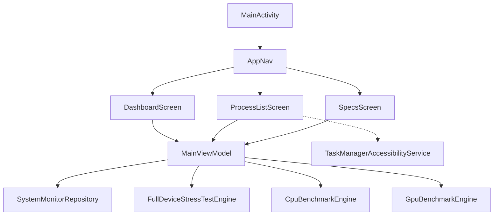

<div align="center">

# Pulse

### The heartbeat of your device.

Pulse is a modern, high-performance system monitor, hardware benchmarker, and advanced task manager built for Android.


</div>

---

## Why this exists

Modern mobile devices are powerhouse computers, yet understanding real-time system performance, CPU load, GPU utilization, memory pressure, and active background processes often requires cluttered, ad-heavy diagnostic tools.

Pulse turns device telemetry into a clean, responsive, and expressive dashboard. Created natively for Android using Jetpack Compose, Pulse provides instant visibility into hardware performance, real-time metrics, and process control without tracking endpoints, accounts, or intrusive advertisements.

The project is designed around a fast, transparent workflow:

```text
Open app -> View dashboard -> Inspect telemetry & battery -> Run 2-min stress test -> Manage tasks
```

There is no account system, sign-in flow, advertising SDK, telemetry collection, or external data logging.

## What it provides

| Capability | Description |
|------------|-------------|
| Real-time dashboard | Live visual monitoring of CPU, RAM, combined Disk & Storage, and Network statistics |
| Battery & Thermal telemetry | Real-time battery status, charging speed, voltage, health, °C/°F temperature, and throttling alerts |
| 2-Min Full Stress Benchmark | 120-second AnTuTu V10-style hardware stress test with live performance curves and stability ratings |
| Process management | Instant in-app task termination, process memory/thread tracking, and 1-click Auto-Kill service |
| Bento UI specifications | Minimalist Material 3 Expressive Bento Grid breakdown of CPU, L1/L2/L3 cache, RAM, GPU Vulkan, and storage |
| Offline workflow | Complete monitoring and benchmarking without account or network access |

## Features

### Dashboard & Telemetry

- Real-time CPU usage, core frequencies, system threads, and open handle counts
- RAM utilization breakdown (used, total, cached, compressed, committed, paged pool)
- Combined Disk & Storage card with used/free capacity gauge and live flash I/O activity graph
- Network speeds (upload/download), active interface classification (Wi-Fi, 5G/LTE, Ethernet), and signal details
- **Live Battery & Thermal Telemetry**: Battery level %, charging speed (*AC Fast Charge / USB / Wireless / Discharging*), voltage (mV), battery health, dual-unit temperature (°C & °F), 60-second thermal trend graph, and thermal throttling state badges (*Optimal / Warm / Throttling Risk*)

### 2-Min AnTuTu V10 Full Device Extreme Stress Test

- **2-Minute Multi-Stage Benchmark Engine** (`FullDeviceStressTestEngine`):
  - **Phase 1 (0–30s) — CPU Multi-Core Compute**: Multi-threaded SHA-512 hashing, matrix math, floating-point vector ops, and prime number sieve calculations.
  - **Phase 2 (30–60s) — GPU Shader & Matrix Stress**: 160×160 3D float matrix dot products and shader compute workloads.
  - **Phase 3 (60–90s) — RAM Bandwidth & Churn**: 32 MB high-velocity buffer memory allocations with XOR bitwise churn.
  - **Phase 4 (90–120s) — Flash I/O & Combined Thermal Load**: 10 MB flash block writes with kernel sync (`fdatasync()`) under heavy CPU load.
- **AnTuTu V10 Normalized Scoring**: Calculates CPU, GPU, RAM, and Storage sub-scores, overall hardware PTS score, tier grade (*S+ Ultra Flagship, S Tier, A Tier, B Tier, C Tier*), peak temperature, and 120s Performance Retention Stability Rating %.
- **Live Performance Curve**: Renders real-time 120-second output curves during and after the test.

### Task Manager

- Instant in-app task ending with zero page redirection
- Comprehensive list of running processes with app icons, PID, package name, RAM usage, and CPU%
- Search bar and multi-criteria sorting (RAM, CPU, Name, I/O)
- Optional 1-click Auto-Kill via `TaskManagerAccessibilityService`

### Material 3 Expressive Bento Grid Specs

- **Hero Device Header**: Model name, Android OS version badge, and active network interface
- **Processor & Architecture**: Core counts, logical threads, base speed, virtualization (VT-x / ARM), and L1/L2/L3 cache sizes
- **Memory & Storage Bento Cards**: Total RAM, memory speed, form factor, storage technology type, and flash health
- **GPU & Display**: GPU chipset model, Vulkan API version badge, OpenGL driver version, and physical allocation

## Quick start

### Requirements

- Android Studio (Ladybug / Jellyfish or newer recommended)
- Android SDK 37 (compileSdk / targetSdk)
- JDK 17 or higher
- Android Gradle Plugin 9.x
- Kotlin 2.2.10
- An Android device or emulator (minSdk 24)

### Clone the repository

```bash
git clone https://github.com/iabhnv19/Pulse.git
cd Pulse
```

### Open in Android Studio

1. Open Android Studio.
2. Select **Open** and choose the repository directory.
3. Wait for Gradle sync to finish.
4. Connect a device or start an emulator.
5. Select the `app` run configuration.
6. Press **Run**.

## Build and test

### Windows

Build a debug APK:

```bat
gradlew.bat assembleDebug
```

Run local unit tests:

```bat
gradlew.bat testDebugUnitTest
```

### macOS and Linux

```bash
./gradlew assembleDebug
./gradlew testDebugUnitTest
```

The debug APK is generated at:

```text
app/build/outputs/apk/debug/app-debug.apk
```

## Architecture



### Main responsibilities

| Component | Responsibility |
|-----------|----------------|
| `MainActivity` | Sets up window insets and launches Compose UI root |
| `MainViewModel` | Manages state flows for system stats, processes, thermal trends, and benchmarks |
| `SystemMonitorRepository` | Gathers real-time CPU, GPU, RAM, Disk, Network, and Battery telemetry from Linux procfs/sysfs |
| `FullDeviceStressTestEngine` | Executes 2-minute multi-stage hardware stress test and computes AnTuTu V10 scores & stability ratings |
| `TaskManagerAccessibilityService` | Optional accessibility service for 1-click automated Force Stop execution |
| `DashboardScreen` | Renders performance cards, battery/thermal telemetry, real-time graphs, and 2-min stress test |
| `ProcessListScreen` | Displays active tasks, thread counts, memory usage, search/sorting, and instant task manager |
| `SpecsScreen` | Renders hardware breakdown using Material 3 Expressive Bento Grid UI |

## License

Pulse is released under the [Apache License 2.0](LICENSE).

## Developer

<div align="center">

Developed By

<table>
  <tr>
    <td align="center">
      <a href="https://github.com/iabhnv19">
        
        <br />
        <strong>Abhinav</strong>
        <br />
        @iabhnv19
      </a>
    </td>
  </tr>
</table>

**Built with Kotlin and Jetpack Compose for powerful device monitoring and benchmarking.**

</div>
